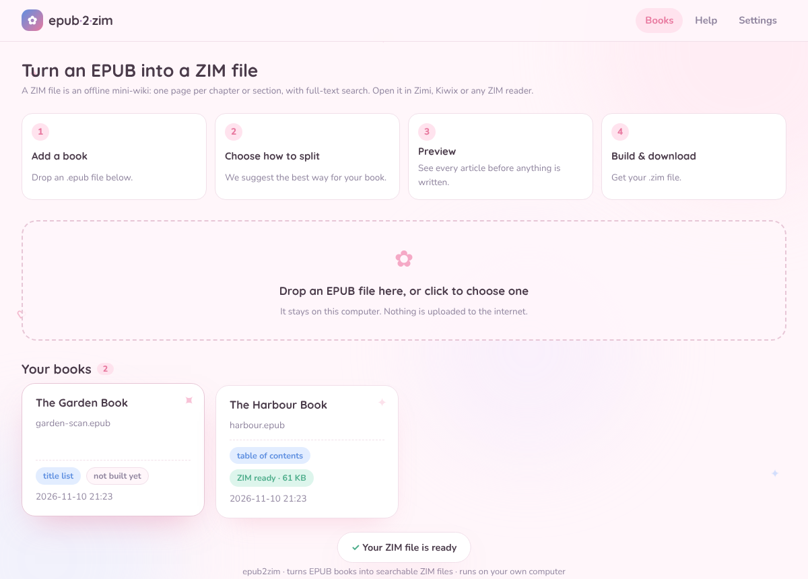
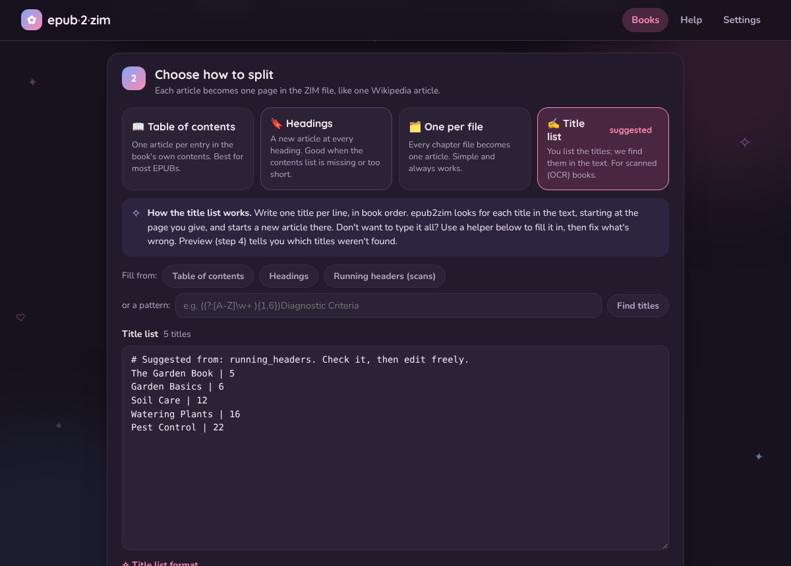
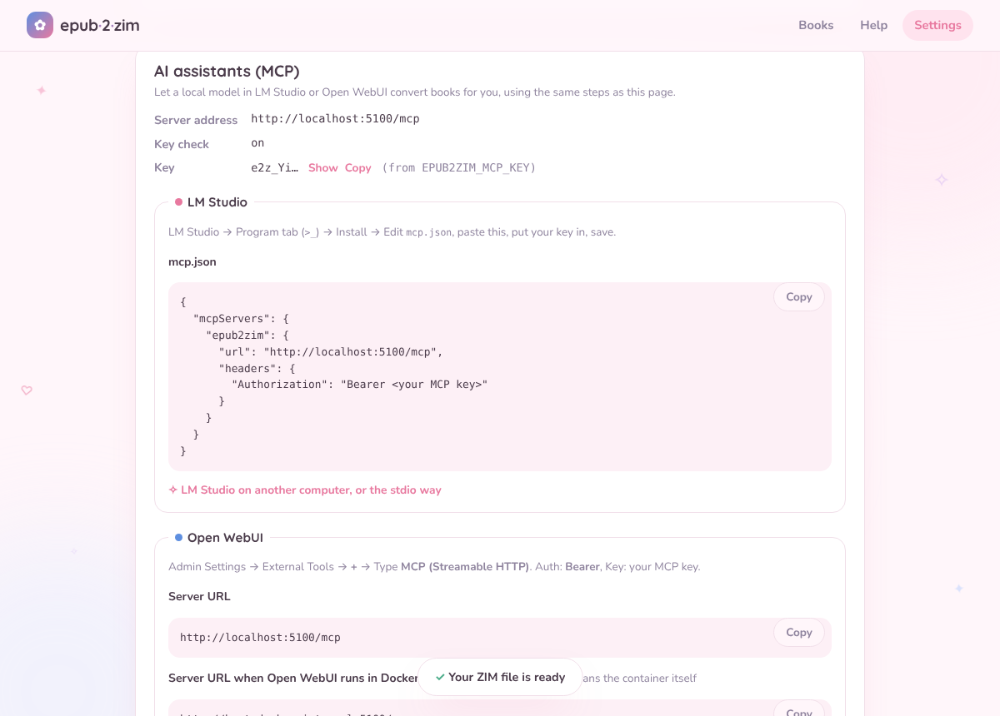

# ✿ epub2zim

**Turn EPUB books into searchable, wiki-style ZIM files** for Zimi, Kiwix and any other
ZIM reader. Runs on your own computer in Docker, with a friendly web UI and an
**MCP server** so local AI assistants (LM Studio, Open WebUI…) can do the converting for you.

There are plenty of tools for going *from* ZIM *to* EPUB. This one goes the other way.



## What you get

- **One article per chapter, section or entry**, not one giant page. Nested sections
  become nested articles with breadcrumbs and *In this section* lists.
- **Full-text search** and search-as-you-type titles, built into the ZIM.
- **Wiki-style links**: mentions of other article titles become links.
- **Aliases**: extra search names (`PTSD` → *Posttraumatic Stress Disorder*).
- **Pictures**, the book's metadata and its cover as the library icon.
- **Scanned (OCR) books work too**: page numbers and running headers are removed, and a
  *title list* (filled automatically from running headers or a pattern) decides where
  articles start.
- **Preview before building**: every article, with its size and first words, plus
  warnings for titles that weren't found.

## Quick start (Docker)

```bash
git clone https://github.com/danielcodedthis/epub2zim.git
cd epub2zim
docker compose up -d
```

Open **http://localhost:5100**, drop an EPUB, follow the five steps, download your `.zim`.
Books, settings and results live in `./data` (every finished ZIM is also copied to
`./data/output`).

<details>
<summary>Without Docker (pip)</summary>

```bash
git clone https://github.com/danielcodedthis/epub2zim.git && cd epub2zim
python -m venv .venv && source .venv/bin/activate      # Windows: .venv\Scripts\activate
pip install .
epub2zim serve                                          # http://localhost:5100
epub2zim convert mybook.epub                            # or straight from the command line
```
Python 3.10+.
</details>

## How it works

```
EPUB ─► read ─► blocks (or clean scanned pages) ─► split into articles ─► tidy HTML + links ─► ZIM
```

Pick how to split the book:

| Strategy | Cuts at | Best for |
|---|---|---|
| 📖 Table of contents | each entry of the book's contents | most EPUBs |
| 🔖 Headings | every `<h1>`…`<hN>` | missing / too-short contents |
| 🗂️ One per file | each HTML file | fallback, always works |
| ✍️ Title list | your titles, found in the text | scanned / OCR books |

epub2zim looks at the book and suggests one. Details:
[How it works](docs/how-it-works.md) · [Splitting strategies](docs/splitting-strategies.md) ·
[Scanned books](docs/scanned-books.md).



## Configuration

| Variable | Default | Meaning |
|---|---|---|
| `EPUB2ZIM_PORT` | `5100` | Port for the web UI, API and MCP server |
| `EPUB2ZIM_DATA_DIR` | `./data` (`/data` in Docker) | Data folder (compose: `EPUB2ZIM_DATA` picks the folder on your computer) |
| `EPUB2ZIM_MCP_KEY` | generated | Key AI assistants must send (`Authorization: Bearer <key>`) |
| `EPUB2ZIM_MCP_AUTH` | `on` | `off` disables the key check |
| `EPUB2ZIM_HOST` | `127.0.0.1` (`0.0.0.0` in Docker) | Listening address |
| `EPUB2ZIM_MAX_UPLOAD_MB` | `300` | Largest upload |
| `PUID` / `PGID` | `1000` | Docker: owner of the data files |

Copy `.env.example` to `.env` to set them for docker compose. More:
[Configuration](docs/configuration.md) · [Docker](docs/docker.md).

## AI assistants (MCP)

epub2zim speaks the [Model Context Protocol](https://modelcontextprotocol.io) at
`http://localhost:5100/mcp` (Streamable HTTP, Bearer key) or over stdio
(`epub2zim mcp-stdio`). Its tools mirror the web UI: `import_epub`, `inspect_book`,
`read_pages`, `find_text`, `suggest_titles`, `set_title_list`, `update_settings`,
`preview_split`, `build_zim` and more. Answers are kept short so small local models can
follow.

**LM Studio** (`mcp.json`):

```json
{ "mcpServers": { "epub2zim": {
    "url": "http://localhost:5100/mcp",
    "headers": { "Authorization": "Bearer YOUR-KEY" } } } }
```

**Open WebUI**: Admin Settings → External Tools → + → Type **MCP (Streamable HTTP)**,
URL `http://host.docker.internal:5100/mcp` (if Open WebUI runs in Docker), Auth **Bearer**.

The Settings page shows your key and copy-ready snippets. Guides:
[MCP server](docs/mcp-server.md) · [LM Studio](docs/lm-studio.md) ·
[Open WebUI](docs/open-webui.md).



### Skills

[`skills/`](skills/README.md) holds ready-made instructions for assistants: convert a
book, handle a scanned book, explain epub2zim to a user, and set up the MCP server. Paste one
into a system prompt or load it as a skill.

## Command line

```bash
epub2zim inspect book.epub                                   # what kind of book? which strategy?
epub2zim suggest scan.epub --method running_headers > titles.txt
epub2zim preview scan.epub --strategy titles --titles titles.txt
epub2zim convert scan.epub --strategy titles --titles titles.txt -o scan.zim
```

See [Command line](docs/cli.md) and [REST API](docs/api.md).

## Documentation

Everything is in [`docs/`](docs/README.md): getting started, Docker, configuration, the web
UI, how it works, strategies, the title list format, scanned books, aliases, MCP, LM Studio,
Open WebUI, CLI, API, architecture, troubleshooting and FAQ.

## Project layout

```
src/epub2zim/          the Python package: small modules, one job each (see docs/architecture.md)
  splitters/           the four splitting strategies
  web/                 REST API, app assembly, and the Blush web UI (static/, no build step)
  mcp_server.py        MCP tools for AI assistants
tests/                 pytest suite; builds tiny EPUBs on the fly
docs/                  documentation
skills/                instructions for AI assistants
Dockerfile, docker-compose.yml, docker/entrypoint.sh
```

## Development

```bash
pip install -e ".[dev]"
pytest                       # tests
epub2zim serve --port 5100   # edit files in web/static and just reload the page
```

Every module starts with a comment explaining its job, and
[Architecture](docs/architecture.md) shows where to make common changes (new strategy, new
MCP tool, new setting). Pull requests welcome.

## A note on copyright

epub2zim is a tool for books you have the right to use. A ZIM made from a copyrighted book is
for your personal use: please don't share it. Public-domain books (e.g. Project Gutenberg)
are a great place to start.

## License

**GPL-3.0-or-later** (see [LICENSE](LICENSE)). In short: everyone may use, study, change and
share epub2zim for free, and anyone who shares a changed version must share it under the
same license, with its source code. That keeps every improvement free for everyone.

Bundled fonts Nunito and Quicksand: SIL Open Font License. Built on
[libzim](https://github.com/openzim/python-libzim) by openZIM (also GPL-3.0).
